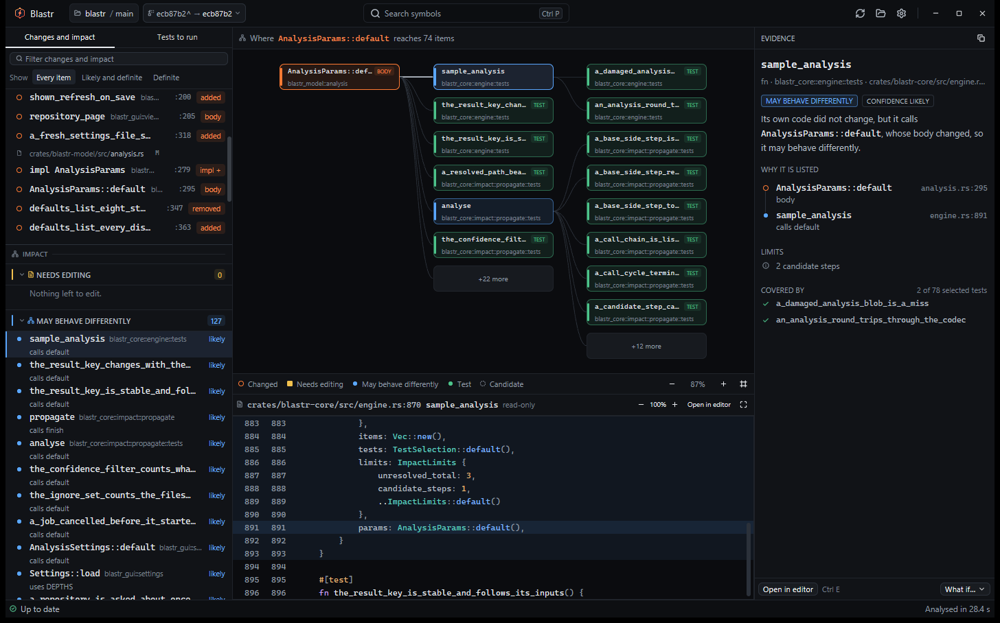

<p align="center">
  <picture>
    <source media="(prefers-color-scheme: dark)" srcset="assets/brand/wordmark-dark.svg">
    
  </picture>
</p>

<p align="center">
  <b>See what a Rust change can reach, and why.</b><br>
  A desktop workspace that compares two revisions of a Cargo project, classifies what changed,<br>
  and shows the code and tests the change can affect — with the evidence for every link.
</p>

<p align="center">
  
  
  
  
  <a href="https://ko-fi.com/zix3r"></a>
</p>

<p align="center">
  
</p>

---

`git diff` shows which lines changed. Blastr shows **what changed structurally**, **which other code
and tests that change can reach**, and **the path that connects them**.

- **It knows what kind of change you made.** Remove a struct field and it lists the code that uses
  *that field*, not every user of the struct. Add an enum variant and it points at the `match`
  blocks whose `_` arm will now quietly catch it. Change a trait's default method and it skips the
  impls that override it.
- **Two clear answers.** *Needs editing* — code that refers to something whose shape changed.
  *May behave differently* — code that still compiles but now runs through changed code.
- **Ranked, with evidence.** Items are ordered by how directly and how certainly they are reached,
  and each one carries the chain of calls and references that links it to the change.
- **The tests worth running.** The tests that reach the change, as `cargo test` commands ready to copy.
- **Honest about its limits.** Unresolved references, dynamic dispatch and inactive `cfg` code are
  shown next to the result they affect, never hidden.

Everything runs locally. Nothing is sent anywhere.

## Getting started

Blastr needs the Rust toolchain your project already uses; nothing else.

### Download

Every [release](https://github.com/zix3r/blastr/releases) carries ready-made binaries, with a
`SHA256SUMS` file to check them against:

| Platform | Archive | Install |
|---|---|---|
| Windows x86_64 | `blastr-<version>-windows-x86_64.zip` | Unzip anywhere and run `blastr.exe`. |
| Arch Linux x86_64 | `blastr-<version>-archlinux-x86_64.tar.gz` | Unpack into `~/.local` or `/usr/local` (`tar -xzf … --strip-components=1 -C ~/.local`); this adds `blastr` to `bin` and a desktop entry with its icon. |

Each archive holds two programs that belong together: the window, `blastr`, and the analysis engine,
`blastr-engine`, which the window starts from its own folder. Keep them side by side.

### From crates.io

```sh
cargo install blastr
```

This builds and installs both programs into `~/.cargo/bin`. On Linux it needs the system packages
listed below.

### Build from source

The pinned toolchain in `rust-toolchain.toml` installs itself on first use:

```sh
git clone https://github.com/zix3r/blastr
cd blastr
cargo build --release -p blastr
```

Both programs land in `target/release`.

<details>
<summary>Linux: system packages</summary>

```sh
sudo apt-get install -y build-essential cmake clang lld pkg-config libssl-dev libzstd-dev \
  libsqlite3-dev libgit2-dev libglib2.0-dev libfontconfig-dev libwayland-dev libx11-xcb-dev \
  libxkbcommon-dev libxkbcommon-x11-dev libvulkan1 libvulkan-dev libasound2-dev
```
</details>

### Use

Start `blastr` inside a repository, pass it a folder (`blastr path/to/project`), or open one from
the start screen. Uncommitted changes are compared against `HEAD` straight away; pick any commit, or
shift-click a range, to compare that instead. With the working tree selected, every save refreshes
the result in about a second.

| Keys | |
|---|---|
| <kbd>Ctrl</kbd> <kbd>P</kbd> | Find any symbol |
| <kbd>Ctrl</kbd> <kbd>1</kbd> / <kbd>2</kbd> / <kbd>3</kbd> | Graph, source, before and after |
| <kbd>Alt</kbd> <kbd>←</kbd> / <kbd>→</kbd> | Back and forward through the selection |
| <kbd>Ctrl</kbd> <kbd>E</kbd> | Open the selected location in your editor |
| <kbd>Ctrl</kbd> <kbd>,</kbd> | Settings |
| <kbd>Esc</kbd> | Cancel the running analysis |

## How it works

Blastr loads both revisions with [rust-analyzer](https://rust-analyzer.github.io/), built in as a
library, and turns each into a graph of symbols and the references between them. It matches the
symbols across the two sides (renames and moves included), classifies every difference, and then
follows the references backwards from each change using rules specific to its kind. Graphs and
results are cached per revision and configuration, so the second look at a commit is instant.

The analysis runs in a separate engine process, the way editors run rust-analyzer: a slow or failed
load never freezes or crashes the window.

> [!NOTE]
> Loading a Cargo project runs its **build scripts and procedural macros**, exactly as building it
> would. Blastr asks once per repository; choose *Open restricted* for code you do not trust —
> generated code is then invisible and the result says so.

## Settings

There is no configuration file in the repository. Everything is set in the window, from the gear
in the title bar or <kbd>Ctrl</kbd> <kbd>,</kbd>:

- **Editor** — which editor *open in editor* starts, picked from the ones found on this machine, or
  a command of your own with `{file}`, `{line}` and `{column}` placeholders.
- **Analysis** — how far impact is followed, the lowest confidence that is listed, and whether a
  comparison of the working tree runs again when a file is saved.
- **This repository** — its Cargo features or all of them, a target triple, ignore patterns, and
  whether build scripts and procedural macros may run.

A change applies at once; anything the analysis depends on runs the comparison again. The settings
are kept in your user configuration directory (`%APPDATA%\blastr` on Windows, `~/.config/blastr` on
Linux, `~/Library/Application Support/blastr` on macOS), beside the cache, so nothing about your
machine ends up in a commit.

## Status

Blastr is a bachelor's project at Kaunas University of Technology, built to be used. It is in
active development and has not been released yet.

## Support

Blastr is free and open source, and built in spare hours. If it saved you a debugging session or
an unnecessary full test run, you can buy me a coffee — it keeps the work going.

<a href="https://ko-fi.com/zix3r"></a>

## Licence

Dual-licensed under [MIT](LICENSE-MIT) or [Apache 2.0](LICENSE-APACHE), at your option.
